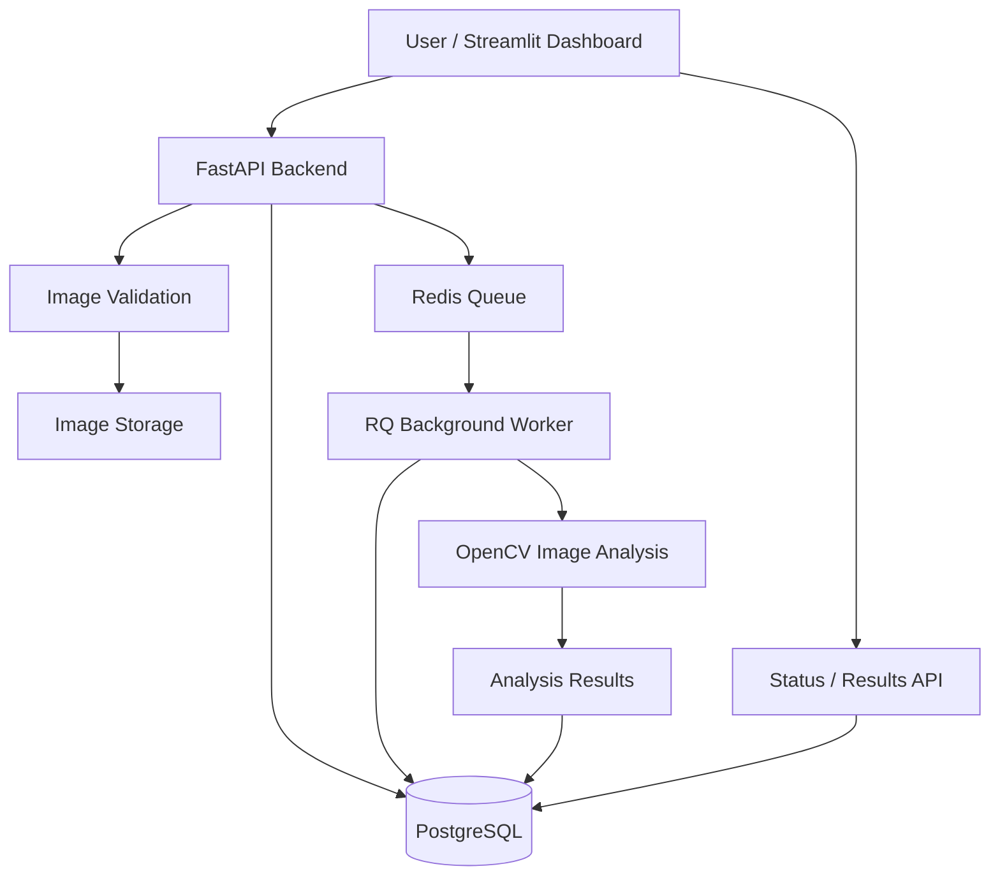

# gOGig Lens
### Intelligent Image Processing & Quality Screening Platform

<p align="center">
  
</p>

<p align="center">
  <b>01 — Onboarding Experience</b>
</p>

<br/>

<p align="center">
  
</p>

<p align="center">
  <b>02 — Analysis Summary</b>
</p>

<br/>

<p align="center">
  
</p>

<p align="center">
  <b>03 — Processing Timeline</b>
</p>

---

<p align="center">
  <b>Python · FastAPI · PostgreSQL · Redis · RQ · OpenCV · Streamlit · Docker</b>
</p>

## Overview

**gOGig Lens** is an image upload and analysis platform developed for the Ginger Media Group Backend + AI Engineering take-home assignment.

It is designed around an asynchronous image-processing pipeline that separates API request handling from background analysis.

Users can submit images, receive a unique processing ID, track job status, and retrieve analysis results through REST APIs and an interactive Streamlit dashboard.

The primary engineering focus is modular backend architecture, asynchronous processing, persistent metadata, and practical image-quality screening.

## Features

- REST API for image uploads.
- Unique processing ID generation.
- Image validation and storage.
- Asynchronous background processing with Redis Queue (RQ).
- PostgreSQL-based metadata persistence.
- Processing states: `pending`, `processing`, `completed`, `failed`.
- Image quality and metadata analysis.
- Processing status and results endpoints.
- Interactive Streamlit dashboard.
- Docker and Docker Compose configuration.
- Configurable local and Cloudflare R2 object storage.

## Image Analysis Capabilities

The pipeline includes or explores the following image checks:

| Analysis | Description |
|---|---|
| Blur Detection | Estimates image sharpness using image-processing techniques. |
| Brightness Analysis | Evaluates image brightness and low-light conditions. |
| Dimension Validation | Checks image width, height, and dimensions. |
| Duplicate Detection | Compares image fingerprints to identify potential duplicates. |
| OCR Extraction | Provides text-extraction functionality. |
| Number Plate Analysis | Includes analysis of Indian vehicle registration formats. |

**Note:** These checks are intended for automated screening assistance. They do not guarantee image authenticity. OCR and number-plate recognition have limitations and require further validation before production use.

## System Architecture



### Processing Workflow

1. **Upload:** The user submits an image through the dashboard or API.
2. **Validation:** FastAPI validates the uploaded image.
3. **Identification:** A unique processing ID is generated.
4. **Persistence:** Image metadata and processing information are stored in PostgreSQL.
5. **Queueing:** A background job is submitted to Redis Queue.
6. **Processing:** An RQ worker performs image analysis independently of the API request.
7. **Results:** The analysis output and job status are persisted.
8. **Retrieval:** The client retrieves processing status and results through the API.

### Queue Strategy

Redis Queue (RQ) is used to separate image processing from API request handling.

The API can acknowledge a valid upload without waiting for the complete analysis. The worker processes queued jobs independently, allowing the application to handle longer-running tasks outside the request-response lifecycle.

## Technology Stack

| Technology | Purpose |
|---|---|
| Python | Application and processing logic |
| FastAPI | REST API development |
| PostgreSQL | Persistent metadata storage |
| Redis | Queue infrastructure |
| RQ | Background job processing |
| OpenCV | Image analysis |
| Streamlit | Interactive dashboard |
| Cloudflare R2 | Configurable object storage |
| Docker | Containerization |
| Docker Compose | Local service orchestration |
| Render | Backend hosting |
| GitHub | Version control and source code |

## Project Structure

```text
gOGig_lens/
│
├── app/
│   ├── queue.py
│   ├── reaper.py
│   ├── schemas.py
│   ├── storage.py
│   └── worker.py
│
├── data/
│
├── img/
│   ├── onboard.png
│   ├── summary.png
│   └── timeline.png
│
├── tests/
│
├── .env.example
├── .gitignore
├── alembic.ini
├── docker-compose.yml
├── Dockerfile
├── requirements.txt
├── streamlit_app.py
└── README.md
```

## Getting Started

### Prerequisites

- Python 3.11
- Docker and Docker Compose
- Git

### 1. Clone the repository

```bash
git clone https://github.com/mayankptdr/gOGig_lens.git
cd gOGig_lens
```

### 2. Create a virtual environment

```bash
python -m venv .venv
```

Activate the environment:

**Windows PowerShell**
```powershell
.venv\Scripts\Activate.ps1
```

**Linux / WSL**
```bash
source .venv/bin/activate
```

### 3. Install dependencies

```bash
pip install -r requirements.txt
```

### 4. Configure environment variables

Create a `.env` file using `.env.example` as a reference.

Configure the required database, Redis, storage, and application settings.

Example configuration keys:

```env
DATABASE_URL=
REDIS_URL=
UPLOAD_DIR=data/uploads
STORAGE_BACKEND=local

R2_BUCKET_NAME=
R2_ENDPOINT_URL=
R2_ACCESS_KEY_ID=
R2_SECRET_ACCESS_KEY=
R2_REGION=auto
```

Do not commit `.env` files or credentials to GitHub.

### 5. Start supporting services

```bash
docker compose up -d
```

### 6. Start the FastAPI backend

```bash
python -m uvicorn app.main:app --reload
```

### 7. Start the background worker

Run the worker in a separate terminal with the same Redis and database configuration as the API:

```bash
rq worker --with-scheduler image-processing --url "$REDIS_URL"
```

### 8. Start the Streamlit dashboard

```bash
streamlit run streamlit_app.py
```

The dashboard will normally be available at:

```text
http://localhost:8501
```

## API Documentation

The FastAPI backend provides interactive API documentation through Swagger UI.

**[Open gOGig Lens API Documentation](https://gogig-lens-api.onrender.com/docs)**

The API supports image submission and processing status/results retrieval. Refer to the live Swagger documentation for the currently exposed endpoint schemas and request formats.

## Deployment

The project has been configured across multiple services:

| Component | Platform | Status |
|---|---|---|
| Source Code | GitHub | Available |
| FastAPI Backend | Render | Deployed |
| PostgreSQL | Render | Configured |
| Redis | Render | Configured |
| Dashboard | Streamlit Community Cloud | Deployed |
| Object Storage | Cloudflare R2 | Configured |
| Cloud Worker Integration | Cloud Environment | Requires further verification |

### Deployment Limitation

The dashboard and backend are deployed separately. During final integration, a connectivity issue affected the complete cloud-based image-processing workflow.

The local processing pipeline has been used for the working demonstration. A fully reliable, always-on cloud worker integration is still pending.

The public dashboard should therefore not be interpreted as proof that the entire cloud processing workflow is currently operational.

## Trade-offs and Known Limitations

Some implementation decisions were kept intentionally practical to fit the assignment scope.

- Image checks rely on traditional image-processing techniques and heuristics rather than a fully trained image-authenticity model.
- OCR and number-plate analysis need further accuracy testing.
- Duplicate detection can require better fingerprinting and threshold calibration.
- The confidence indicator is a screening summary, not a calibrated probability.
- Worker reliability, retry behavior, and failure recovery need further hardening.
- Authentication, authorization, and rate limiting are not yet complete.
- Large-image processing requires additional memory and performance controls.
- Cloud worker connectivity requires further integration testing.

## AI Usage Disclosure

AI tools were used as development assistance during the project.

### Where AI Was Used

- Exploring backend architecture and implementation approaches.
- Understanding image-processing techniques and possible validation checks.
- Debugging Python, API, and dependency issues.
- Reviewing code structure and improving documentation.
- Investigating deployment and infrastructure configuration.

### How AI Output Was Validated

AI-generated suggestions were treated as recommendations rather than automatically correct solutions.

Code and configuration were reviewed against the actual project, and relevant changes were checked through local execution, API testing, and debugging.

### What Did Not Work as Expected

Some generated implementation and deployment suggestions required correction during integration.

In particular, connecting separately hosted dashboard, backend, Redis, and background worker services exposed configuration and connectivity issues. These were investigated through logs and local testing.

This reinforced the importance of validating generated code and infrastructure changes in the actual execution environment.

## Future Improvements

- Reliable always-on background worker deployment.
- Stronger OCR and number-plate recognition.
- More robust duplicate detection.
- Improved retry and failure-recovery mechanisms.
- Automated integration and load testing.
- Authentication and access control.
- Structured logging and operational monitoring.
- Performance optimization for large images.

## Repository

**GitHub:** [github.com/mayankptdr/gOGig_lens](https://github.com/mayankptdr/gOGig_lens)

**API Documentation:** [gogig-lens-api.onrender.com/docs](https://gogig-lens-api.onrender.com/docs)

---

<p align="center">
  <b>gOGig Lens</b><br>
  Built by Mayank Patidar
</p>
