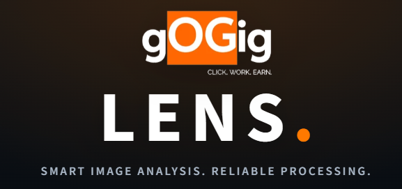
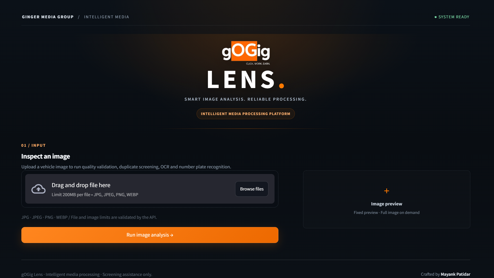
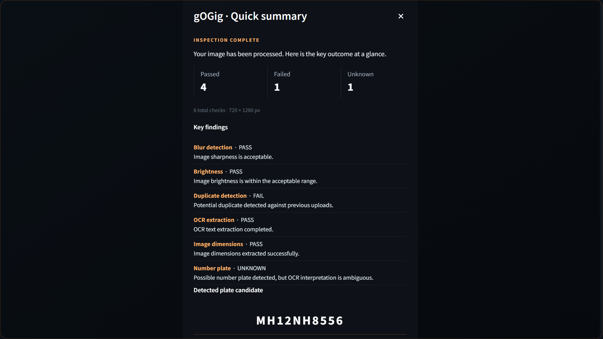
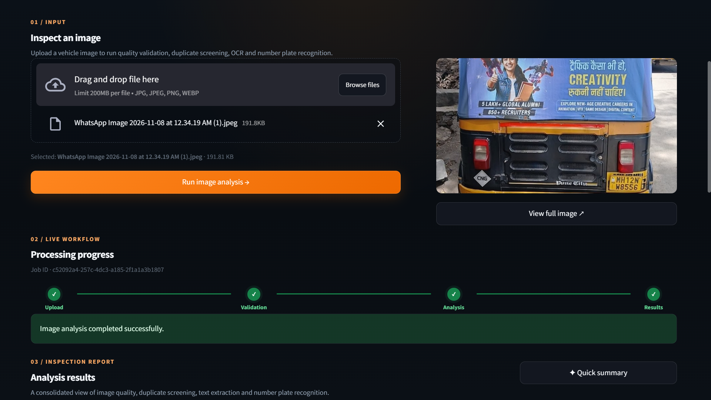
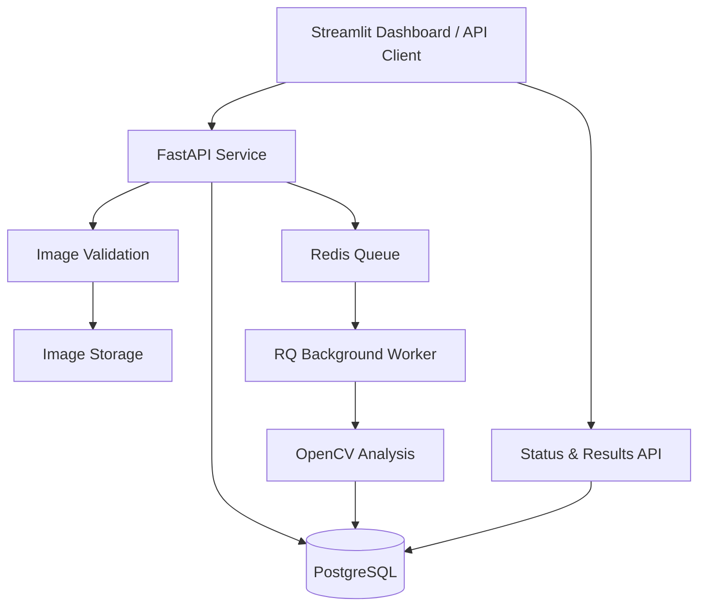

 <div align="center">



**IMAGE INTELLIGENCE · ASYNCHRONOUS PROCESSING · QUALITY SCREENING**

[Live Application](https://gogig-lens.streamlit.app/) · [Product Demo](https://youtu.be/kqymIBQUKmM?si=iFeqQ2utAF5RGZto) · [API Reference](https://gogig-lens-api.onrender.com/docs) · [Source Code](https://github.com/mayankptdr/gOGig_lens)


</div>

---

## Executive Summary

**gOGig Lens** is an image-processing and quality-screening platform developed for the Ginger Media Group Backend + AI Engineering take-home assignment.

The platform integrates image ingestion, validation, asynchronous processing, persistent job tracking and result presentation into a unified workflow.

A FastAPI service accepts image submissions and assigns each image a unique processing identifier. Redis Queue dispatches analysis tasks to a dedicated background worker, while PostgreSQL maintains processing metadata and results. A Streamlit application provides the user-facing experience.

The engineering objective is to keep the API responsive, isolate processing workloads and make every job traceable from submission to result retrieval.

## Product Experience

<p align="center">
  
</p>
<p align="center"><sub>IMAGE SUBMISSION · A focused entry point for the analysis workflow</sub></p>

<p align="center">
  
</p>
<p align="center"><sub>ANALYSIS SUMMARY · Review the output of image screening</sub></p>

<p align="center">
  
</p>
<p align="center"><sub>JOB OBSERVABILITY · Follow processing status through the pipeline</sub></p>

## Platform Capabilities

| Domain | Capability |
|---|---|
| Ingestion | Image submission through dashboard and REST API |
| Validation | Uploaded-file validation before processing |
| Job orchestration | Unique processing IDs and lifecycle tracking |
| Background execution | Redis Queue with dedicated workers |
| Image screening | Blur, brightness and dimension analysis |
| Additional checks | Duplicate screening, OCR and number-plate analysis |
| Persistence | PostgreSQL-backed metadata and results |
| Storage | Local storage and configurable Cloudflare R2 |
| Result access | Processing status and analysis retrieval |

**Job lifecycle:** `pending` → `processing` → `completed` / `failed`

> The platform provides image-screening assistance, not guaranteed image-authenticity verification. OCR, number-plate recognition and confidence indicators have limitations and require validation for high-stakes use.

## System Architecture

The system separates the synchronous API layer from background image-processing workloads.



### Request-to-result lifecycle

1. **Submit** — A client uploads an image through the dashboard or API.
2. **Validate** — The backend checks the incoming file.
3. **Register** — The system creates a processing identifier and records job metadata.
4. **Enqueue** — The analysis task is dispatched to Redis Queue.
5. **Execute** — An independent RQ worker performs the configured image checks.
6. **Persist** — Job state and analysis output are written to PostgreSQL.
7. **Retrieve** — The client requests the current status and available results.

### Architectural rationale

- **Separation of concerns:** API request handling and image analysis run independently.
- **Traceability:** A processing ID provides a reference for an individual submission.
- **Persistence:** Job metadata and results are stored beyond the lifetime of an API request.
- **Extensibility:** The queue-based design provides a clear boundary for additional processing tasks.

## Technology

| Layer | Components |
|---|---|
| Runtime | Python 3.11 |
| API | FastAPI, Uvicorn |
| Image analysis | OpenCV |
| User interface | Streamlit |
| Persistence | PostgreSQL |
| Queue and workers | Redis, RQ |
| Object storage | Local storage, Cloudflare R2 |
| Local infrastructure | Docker, Docker Compose |
| Hosting | Render, Streamlit Community Cloud |

## Repository Structure

```text
gOGig_lens/
├── app/
│   ├── queue.py
│   ├── reaper.py
│   ├── schemas.py
│   ├── storage.py
│   └── worker.py
├── data/
├── img/
│   ├── gogig-logo.png
│   ├── onboard.png
│   ├── summary.png
│   └── timeline.png
├── tests/
├── .env.example
├── .gitignore
├── alembic.ini
├── docker-compose.yml
├── Dockerfile
├── requirements.txt
├── streamlit_app.py
└── README.md
```

## Local Development

### Prerequisites

- Python 3.11
- Git
- Docker and Docker Compose

### Setup

Clone the repository and create a virtual environment:

```bash
git clone https://github.com/mayankptdr/gOGig_lens.git
cd gOGig_lens
python -m venv .venv
```

Activate the environment.

**Windows PowerShell**

```powershell
.venv\Scripts\Activate.ps1
```

**Linux / WSL**

```bash
source .venv/bin/activate
```

Install dependencies:

```bash
pip install -r requirements.txt
```

Create a local `.env` file using `.env.example` as a reference. Configure the required database, Redis, storage and application settings. Never commit credentials or secrets.

Start supporting services:

```bash
docker compose up -d
```

Start the API:

```bash
python -m uvicorn app.main:app --reload
```

Start the background worker in a separate terminal:

```bash
rq worker --with-scheduler image-processing --url "$REDIS_URL"
```

Launch the dashboard:

```bash
streamlit run streamlit_app.py
```

The local dashboard is available at `http://localhost:8501`.

## Deployment & Service Operations

The dashboard and backend are hosted separately, with supporting infrastructure configured through Render.

### Public application endpoints

| Service | Endpoint |
|---|---|
| Application | [gogig-lens.streamlit.app](https://gogig-lens.streamlit.app/) |
| Backend API | [gogig-lens-api.onrender.com](https://gogig-lens-api.onrender.com/) |
| Interactive API reference | [Swagger UI](https://gogig-lens-api.onrender.com/docs) |
| Product walkthrough | [YouTube demonstration](https://youtu.be/kqymIBQUKmM?si=iFeqQ2utAF5RGZto) |

### Render infrastructure management

These are account-level service-management pages. Render authentication may be required; they are not public application endpoints.

| Resource | Management page |
|---|---|
| Background worker | [Worker deployments](https://dashboard.render.com/worker/srv-dbnut2jrjlhs739urbog/deploys) |
| Backend web service | [Web service deployments](https://dashboard.render.com/web/srv-dbnsdirl550s7382r2ug/deploys) |
| PostgreSQL | [Database resource](https://dashboard.render.com/d/dpg-dbns73h5efls73c6u5k0-a) |
| Redis | [Redis resource](https://dashboard.render.com/r/red-dbns7im417fc73ejq5vg) |

**Operational considerations**

The services have been configured as separate deployments. However, successful deployment of individual components does not independently establish end-to-end processing reliability.

Worker connectivity, queue execution, storage access and result retrieval must be verified together. Cloud integration has previously encountered connectivity issues; full cloud-workflow reliability should only be claimed after successful end-to-end validation.

## Engineering Considerations

The implementation is scoped as a practical image-screening system, not a certified image-authenticity solution.

- Image checks use traditional image-processing techniques and heuristics.
- OCR and number-plate analysis require further accuracy evaluation.
- Duplicate detection can benefit from improved fingerprinting and threshold calibration.
- The confidence indicator is a screening summary, not a calibrated probability.
- Worker retries, recovery and operational monitoring need further hardening.
- Authentication, authorization and rate limiting require additional implementation.
- Large-image workloads need further memory and performance controls.
- Cloud worker connectivity requires continued end-to-end validation.

## Development & AI Assistance

AI tools were used as development assistance for architecture exploration, implementation approaches, debugging and documentation.

Suggestions were reviewed against the project and checked through local execution, API testing and debugging.

An important engineering takeaway from the integration work:

**A healthy API is not necessarily a healthy distributed system.**

Queue connectivity, worker execution, storage access and result persistence must be tested as one complete workflow.

## Next Areas of Work

- Strengthen worker reliability, retries and failure recovery.
- Improve OCR, number-plate recognition and duplicate screening.
- Add authentication and access control.
- Expand automated integration and load testing.
- Improve structured logging and operational monitoring.
- Optimize memory use and processing performance for larger images.

---

<div align="center">


**Smart Image Analysis. Reliable Processing.**

Developed by **[Mayank Patidar](https://github.com/mayankptdr)**

[Application](https://gogig-lens.streamlit.app/) · [API Reference](https://gogig-lens-api.onrender.com/docs) · [Demo](https://youtu.be/kqymIBQUKmM?si=iFeqQ2utAF5RGZto) · [Repository](https://github.com/mayankptdr/gOGig_lens)

*Built to process images, not to keep you waiting.*

</div>
